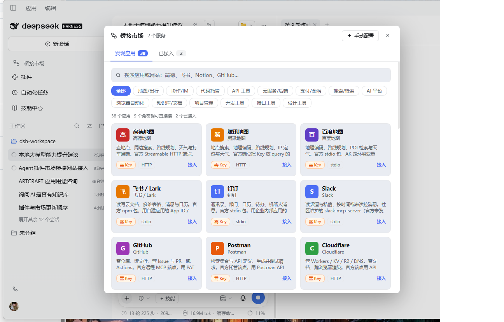
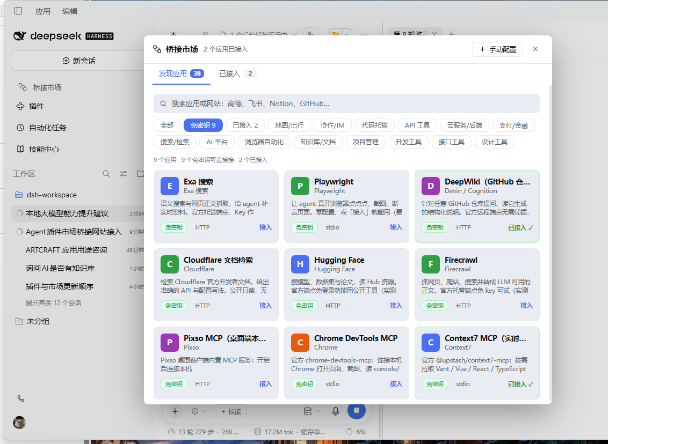
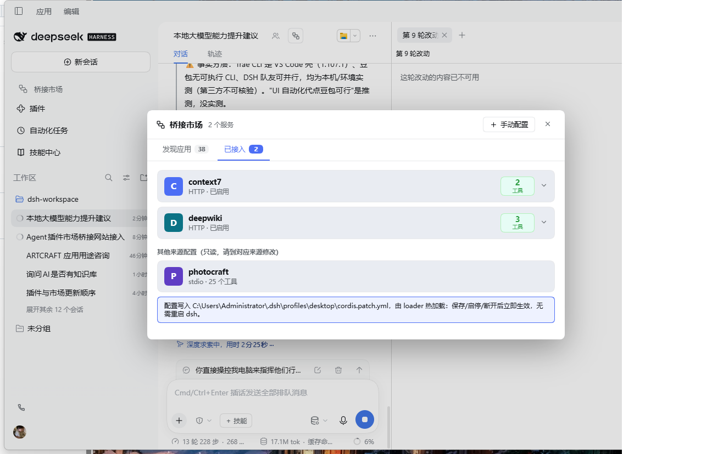
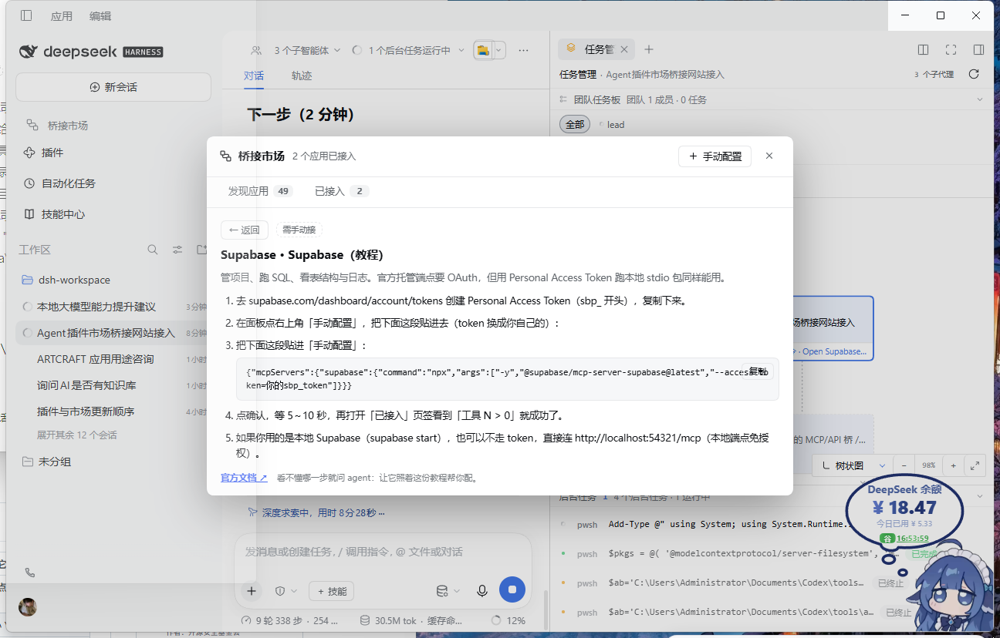

# 桥接市场 · dsh-bridge-market

**给 agent 用的应用商店。** 在列表里挑一个网站或 app，点「接入」，agent 当场就多出一批能调用它的工具——不用记 npm 包名，不用手写 YAML，不用懂 MCP 是什么。



---

## 它解决什么问题

| 没有它 | 有了它 |
| --- | --- |
| 想让 agent 查高德地图，得先去搜「高德 MCP 服务器」的包名、启动命令、参数格式、key 塞哪个环境变量 | 打开面板搜「高德」，点「接入」，把 key 填进那个输入框 |
| 手动改 `cordis.patch.yml`，缩进错一格整行不生效 | 关心里写什么，不关心 YAML |
| 装完不知道到底连上没连上 | 卡片右边直接显示「工具 N」，N 就是 agent 现在真能用的工具个数 |
| 想接十几个 app，配一次忘一次 | 全部在「已接入」页签里，随时停用、编辑、断开 |

一句话：**把「配一个 MCP 服务器」变成「装一个 app」。**

---

## 能干什么

1. **按应用挑，不按包名挑**——目录里的单位是「高德地图」「飞书」「GitHub」，不是 `@xxx/mcp-server-yyy`。
2. **点一下就接入**——写入配置、热加载、工具就位，不用重启 DSH。
3. **接入结果可验证**——每张卡显示「工具 N」，数的是 agent 工具表里真实出现的 `mcp__<应用>__*`，不是猜的。
4. **筛选和搜索**——按分类过滤，另有「免密钥」和「已接入」两个快捷筛选。
5. **四种条目说清楚**——标「免密钥」（直接能用）、「需 Key」（要申请）、「需教程」（官方只走 OAuth，点进去看分步接入）、「仅说明」（当前真接不上，不假装能用）。
6. **agent 自己也能装**——注册了 `bridge_market` 工具，一句「帮我接上高德，key 是 xxx」就能完成。

---

## 怎么用

**第 1 步：安装**

让 agent 装，或手动：

```
plugin_manager  action: install_bundle  target: <本目录的绝对路径>
```

装完**重启一次 DSH**——插件带的工具和面板要在启动时注册。

**第 2 步：打开面板**

左侧边栏点「桥接市场」。两个页签：

| 页签 | 内容 |
| --- | --- |
| 发现应用 | 卡片墙 + 搜索框 + 分类筛选。点卡片或右下角「接入」进配置 |
| 已接入 | 已连上的应用，右键显示工具数，可停用 / 编辑 / 断开 |

右上角「手动配置」可以直接粘贴 Claude Code 的 `.mcp.json` 片段，一次接一批。



**第 3 步：接入并验收**

选应用 → 填 key（如果要）→ 保存 → 看「已接入」页签的**「工具 N」**：

- **N > 0**：真的连上了，agent 现在就能用（MCP 握手是异步的，可能要等 5–10 秒）
- **N = 0**：没连上。依次查 key 对不对、域名通不通、这个端点是不是其实要求 OAuth



**接不上的那种，给教程**

官方只走 OAuth 的应用（Supabase、Linear、Vercel、Intercom）接不了静态 key，所以卡片上标「需教程」，点进去是照抄就能用的分步说明：



---

## 先拿这 9 个练手（都不用申请 key）

| 应用 | 能干什么 |
| --- | --- |
| DeepWiki | 对任意 GitHub 仓库提问，读它的代码结构说明 |
| Context7 | 查某个库/框架的最新官方文档和用法 |
| Cloudflare 文档检索 | 查 Cloudflare 官方文档 |
| Hugging Face | 搜模型、数据集、论文 |
| Firecrawl | 抓网页、爬站，转成 markdown |
| Exa 搜索 | 语义搜索（不填 key 也能用，有速率限制） |
| Playwright | 让 agent 开浏览器、点页面、截图 |
| Chrome DevTools MCP | 连本机 Chrome，截图、读 console、看网络请求 |
| Pixo MCP（桌面端） | 连本机 Pixo 客户端 |

---

## 目录里有什么

**一键接入（点「接入」写配置，刷新就能调）**（`*` = 必填 key）：

| 分类 | 应用 | 需要的 key |
| --- | --- | --- |
| 地图/出行 | 高德地图 | `key*` |
| 地图/出行 | 腾讯地图 | `key*` |
| 地图/出行 | 百度地图 | `BAIDU_MAP_API_KEY*` |
| 地图/出行 | Google Maps | `GOOGLE_MAPS_API_KEY*` |
| 协作/IM | 飞书 / Lark | `appId*`、`appSecret*` |
| 协作/IM | 钉钉 | `DINGTALK_Client_ID*`、`DINGTALK_Client_Secret*` |
| 协作/IM | Slack | `SLACK_MCP_XOXP_TOKEN*` |
| 知识库/文档 | Notion | `token*`（Integration Token） |
| 代码托管 | GitHub | `token*` |
| API 工具 | Postman | `token*` |
| 云服务/后端 | Cloudflare | `token*` |
| 云服务/后端 | Neon Postgres | `apiKey*` |
| 云服务/后端 | Kubernetes | 读本机 kubeconfig，免填 |
| 支付/金融 | Stripe | `token*` |
| 支付/金融 | PayPal | `token*`（可留 `env`，默认沙箱） |
| 搜索/检索 | Exa 搜索 | 可不填 |
| 搜索/检索 | Brave 搜索 | `BRAVE_API_KEY*` |
| 搜索/检索 | DeepWiki | 不需要 |
| 搜索/检索 | Cloudflare 文档检索 | 不需要 |
| 搜索/检索 | Firecrawl | 不需要（不填 key 有额度限制） |
| 搜索/检索 | Tavily 搜索 | `key*` |
| AI 平台 | 魔搭 ModelScope | `MODELSCOPE_API_TOKEN*` |
| AI 平台 | Hugging Face | 不需要（登录后更全） |
| AI 平台 | Sequential Thinking | 不需要 |
| 数据库 | PostgreSQL | 连接串 `*` |
| 数据库 | MySQL / MariaDB | 主机、用户、密码 `*` |
| 数据库 | Elasticsearch | `ES_URL*`、`ES_API_KEY` |
| 本机能力 | 文件系统（限定目录） | 目录路径 `*` |
| 本机能力 | Docker 容器 | 不需要（Docker 要开着） |
| 本机能力 | Memory 知识图谱 | 可不填（本地 JSON） |
| 浏览器自动化 | Playwright | 不需要 |
| 浏览器自动化 | Puppeteer | 不需要 |
| 浏览器自动化 | Browser MCP（操控你自己的浏览器） | 需要先装浏览器扩展 |
| 开发工具 | Sentry | `token*`（自建加 `--host`） |

**4 个教程条目**：Supabase、Linear、Vercel、Intercom。官方只给 OAuth 网页授权，本机连不上，所以不假装能一键接——点卡片进去是分步教程，照抄就能用；Supabase 那条还附了可直接粘进「手动配置」的 JSON。

**2 个说明卡**：Figma、蓝湖——只说明为什么接不上，不写假的接入按钮。

**11 条上游模板**：Apifox、Apipost、MasterGo、Pixso、Chrome DevTools、Context7 等，和上面的目录混在一起显示，界面共 49 条（15 条免密钥，点开即用）。

---

## 让 agent 自己接

插件注册了一个 `bridge_market` 工具：

| action | 作用 |
| --- | --- |
| `list` | 列目录，标「可接入 / 已接入 / 仅说明」，并说明还差哪几个必填键 |
| `attach` | 接入，例如 `{app: "app-amap", config: {key: "…"}}`；缺必填项会直接告诉你要补什么 |
| `detach` | 断开（只能移除本插件自己接的桥） |
| `status` | 列出所有桥和它们的工具数 |

所以你可以直接说：「帮我接上高德地图，key 是 xxx」，然后问「现在高德有哪些工具能用」。

---

## 常见问题

**接入后「工具 N」一直是 0？**
MCP 握手是异步的，等 5–10 秒。仍是 0 就查：key 是否正确、端点域名是否可达、是否要求 OAuth。

**Windows 上 stdio 应用为什么起不来？**
Windows 里 `npx`、`uvx` 这类命令只是 `.cmd` 包装，进程直接按名字启动会失败（实测 `spawnSync("npx")` 报 `ENOENT`）。本插件写配置时会自动改写成 `cmd /c npx ...`，所以面板里接入的都能跑；你自己手写配置或粘贴别人的 JSON 时，要自己补这层包装。

**显示已接入，但 agent 不会用？**
先确认「工具 N」> 0。装了新版本没重启 DSH 的话，面板和 `bridge_market` 工具都不会出现。

**会覆盖我手写的 MCP 配置吗？**
不会。只重写本插件自己两条 marker 之间的内容，文件其余部分逐字节保留；你自己写的行在列表里作为只读条目显示。

**key 存在哪？**
当前 profile 的 `cordis.patch.yml` 里，明文——就是普通配置文件。列表接口返回的是掩码值，面板 HTTP 接口只接受本机（loopback）请求。

**有风险吗？**
有。接入第三方 MCP 等于让外部代码用你的身份跑。标注「社区 MCP」的（靠浏览器自动化或逆向接口的那种）还有账号风控风险。接入前先看条目里的说明和文档链接。

---

## 怎么实现的

每座桥 = 一个 `@deepseek-ai/dsh-mcp-client` 插件实例行，由本插件维护在当前 profile 的 `cordis.patch.yml` 托管区域内：

```yaml
# >>> dsh-bridge-market managed region >>> （请通过「桥接市场」面板管理，勿手改）
- insert:
    - id: mcp-market-context7
      name: '@deepseek-ai/dsh-mcp-client'
      config:
        serverName: context7
        transport: streamable-http
        url: https://mcp.context7.com/mcp
        headers: {}
# <<< dsh-bridge-market managed region <<<
```

三个要点：

1. **profile 自动解析**：上游写死 `profiles/web`，在 desktop / headless profile 下会写进 loader 不监视的文件——面板显示已接入，工具永远不出来。本插件按 `DSH_PROFILE_DIR` → `$DSH_HOME/profiles/<name>` → argv 里 `...\profiles\<name>` → cwd 依次解析。
2. **热加载 + 闭环验证**：写入后 loader 自动重载该行，不必重启；「工具 N」数的是 `tools.schemas()` 里真实出现的 `mcp__<name>__*`。
3. **托管区域**：只重写两条 marker 之间的内容，写入走临时文件 + rename，原子替换。

目录数据在 `src/catalog.js`（`APP_CATALOG`）和 `src/templates.js`（`TEMPLATES`）。**加一个应用 = 加一个对象**，不用改别的地方。

### 开发

```powershell
npm install --no-save esbuild        # build.mjs 用 esbuild 打包客户端
node build.mjs                       # 产出 dist/index.js（host）与 lib/client.js（client）
node --test tests/*.test.mjs         # 12 个用例：托管区读写、CRUD、粘贴解析、bridge_market 工具
```

测试用临时 `DSH_HOME` + `DSH_PROFILE_DIR` 隔离，不会碰真实配置。

---

## 归属

改造自 [Mrxieyong/dsh-mcp-market](https://github.com/Mrxieyong/dsh-mcp-market) v0.2.0（MIT），保留其 LICENSE，以及托管区写入、路由、粘贴解析等基础实现。在此之上新增：应用目录、profile 自动解析、工具数徽标、搜索与分类筛选、`bridge_market` 工具，以及「按应用接入」的产品定位与界面。

MIT License。
